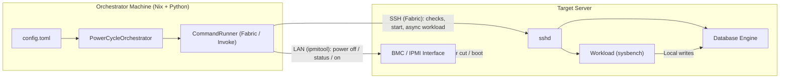
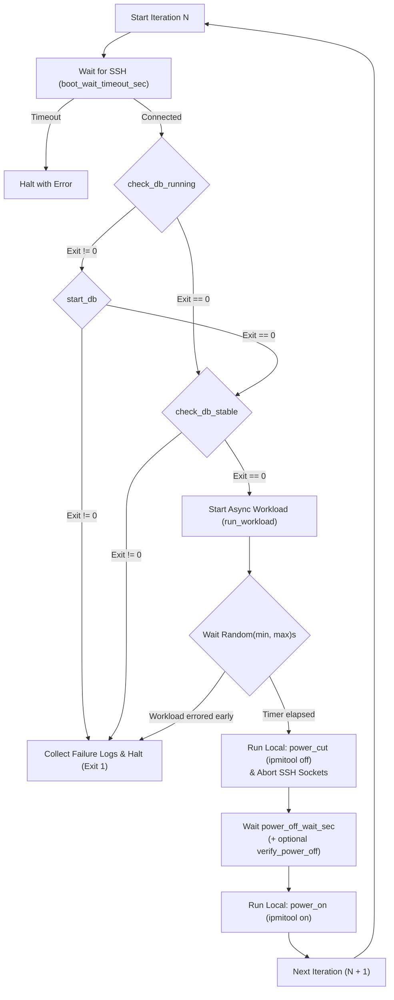

# Power-Cycle Testing of Atomic Support in Databases

## Test Loop

1. **Wait for Remote Reachability:** Poll the remote server until SSH connectivity is established.
2. **Ensure Database is Running:** Check if the database instance is active on the remote server (`commands.remote.check_db_running`).
   - If not running, start the instance (`commands.remote.start_db`).
   - Halt immediately if startup fails.
3. **Verify Stability & Crash Recovery:** Run the stability/consistency check (`commands.remote.check_db_stable`).
   - **Stop testing immediately** if recovery or verification fails, and capture remote diagnostic logs (`commands.remote.collect_failure_logs`).
4. **Drive Remote Workload:** Launch the workload (e.g., `sysbench`) directly on the remote server (`commands.remote.run_workload`) and allow it to run for a randomized window (`workload_run_sec_min` to `workload_run_sec_max`) so power loss hits varied database phases.
5. **Cut Power:** Abruptly cut chassis power from the orchestrator using `ipmitool` (`commands.local.power_cut`), tear down the dead SSH sockets cleanly, and wait/confirm power is off (`power_off_wait_sec` / `commands.local.verify_power_off`).
6. **Restart System:** Power the remote server back on (`commands.local.power_on`).
7. **Repeat:** Loop from step 1 until `max_iterations` is reached or a recovery failure occurs.

---

## System Topology



- **Orchestrator Machine:** Runs on a separate machine on the same network. Never executes the DB workload itself; it coordinates remote commands over SSH and out-of-band power commands over IPMI.
- **Target Database Server:** Runs both the database under test and the workload generator (`sysbench`) locally so network latency does not bottleneck write throughput prior to power loss.

---

## Code Architecture

The implementation uses **Python 3.11+**, **`tomllib`** for configuration, **`fabric` / `invoke` / `paramiko`** for SSH and local command execution, and a **Nix Flake** for reproducible packaging.

### Project Structure

```text
power-cycle/
├── flake.nix                  # Nix flake (app package + devShell with Python, Fabric, ipmitool, OpenSSH)
├── pyproject.toml             # Python build metadata & `power-cycle` CLI entry point
├── config.toml                # Environment settings, loop timings, and remote/local shell commands
├── README.md                  # Operator setup and usage documentation
├── power-cycle.MD             # System design & code architecture specification
└── power_cycle/
    ├── __init__.py
    ├── config.py              # Dataclasses & strict TOML validation (`AppConfig`, `load_config`)
    ├── runner.py              # SSH & local execution (`CommandRunner`, `WorkloadSession`)
    └── orchestrator.py        # Test loop state machine, logging, crash diagnostics, and CLI (`main`)
```

### Module Responsibilities

1. **Configuration Layer (`power_cycle/config.py` + `config.toml`)**
   - Keeps orchestration logic completely decoupled from database-specific or hardware-specific commands.
   - Switching between MySQL/MariaDB, PostgreSQL, or custom storage engines only requires editing `[commands.remote]` in `config.toml`.
   - Switching power controllers (e.g., `ipmitool`, Redfish `curl`, smart PDU CLI) only requires editing `[commands.local]` in `config.toml`.

2. **Execution Layer (`power_cycle/runner.py`)**
   - **`CommandRunner`:** Manages Fabric SSH connections (with explicit `connect_timeout`, `banner_timeout`, `auth_timeout`, TCP keepalives, and `in_stream=False`) and local command execution via `invoke.run`.
   - **`WorkloadSession`:** Opens a dedicated SSH connection on a background daemon thread to run `sysbench` asynchronously.
     - Detects if the workload crashes or exits *before* the power cut so misconfigured workloads do not trigger false test loops.
     - When `power_cut` fires, marks the session as expected-disconnect and forcefully closes the local SSH socket so half-open TCP connections cannot hang the orchestrator.

3. **State Machine & Diagnostics (`power_cycle/orchestrator.py`)**
   - **`PowerCycleOrchestrator`:** Executes the iteration state machine, manages randomized pre-cut workload jitter, and coordinates logging.
   - **Audit & Failure Artifacts:** Writes full execution traces to `logs/power_cycle_<timestamp>.log`. If `start_db` or `check_db_stable` fails, collects remote logs (`collect_failure_logs`), writes `logs/failure_iter_<N>_<timestamp>.log`, and exits with code `1`.

---

## State Machine Flow


